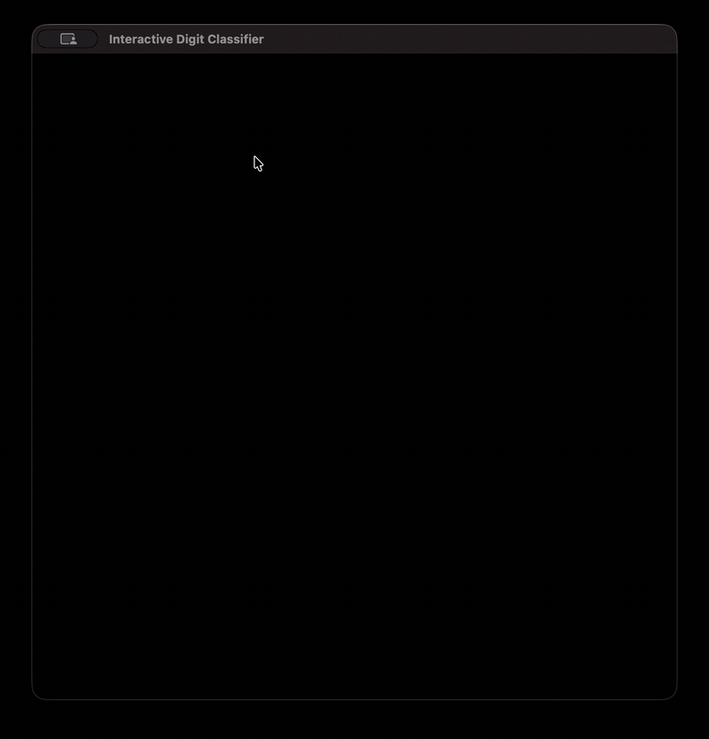
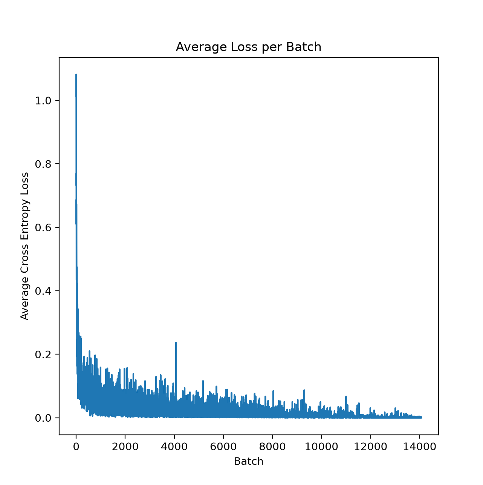

# Neural MNIST Classifier

An interactive digit classifier powered by a neural network trained on the MNIST dataset.



## Table of Contents
- [About](#about)
- [Key Features](#key-features)
- [Performance](#performance)
- [Network Architecture](#network-architecture)
- [Usage](#usage)
- [Challenges](#challenges)
- [Installation](#installation)
- [Future Improvements](#future-improvements)

---

## About

I made this project because I'm really passionate about machine learning. I have been working my way up making bigger and bigger neural networks, and this was the logical next step as the MNIST neural network is commonly known as the "Hello World" of machine learning.

## Key Features
* **No Library Shortcuts:** That's right! All of the math - forward pass, backpropagation, gradient descent, etc. - is coded from scratch, only using numpy for linear algebra. What fun is making a neural network when you let those libraries do all the hard work for you?
* **Uses `scikit-learn` (`fetch_openml`) for Importing the MNIST Dataset:** My only other option (as far as I know) was downloading a `.csv` of the entire dataset on my computer, but that takes up a lot of disk space so I decided to do it this way.
* **Highly Specialized Training Pipeline:** The network uses He initialization for the hidden layer, Xavier initialization for the output layer, and dataset shuffling.
* **Interactive Digit Classifier(`app.py`):** Powered by `pygame`, the user is given a freeform canvas in which they can submit their drawing to the network for a prediction of which digit they drew.
* **Loss Graph:** Once the model is done training, the program uses `matplotlib` to graph the average cross entropy loss per batch.



## Performance
* Takes about **7 seconds** to download the MNIST dataset.
* Spends roughly **2 minutes** on training (depends on your computer).
* Averages **98%** accuracy on the testing dataset.

## Network Architecture
* **Input Layer:** 28x28 pixel images flattened into 784 nodes of grayscale pixel values.
* **Hidden Layer:** 128 nodes with **ReLU** activation and **He initialization**.
* **Output Layer:** 10 nodes with **Softmax** activation and **Xavier initialization**.
* **Hyper Parameters:** a batch size of 64 and a learning rate of 0.01 for 15 epochs

## Usage
**Interactive Digit Classifier**
* Drag left click to draw
* Click `c` to clear the canvas
* Hit `return` to send the image to the network and see its prediction

## Challenges

* **The Interactive Digit Classifier:** It started out as a 28x28 grid that you could drag your mouse across to fill in the cells. This resulted in poor accuracy because each MNIST image was made via taking handwritten digits, centering the digit by its center of mass, and then transforming it into a 28x28 grid of grayscale values. To resemble this process, I switched from drawing on a 28x28 grid to drawing on a freehand canvas that calculates the drawing's center of mass and aligning it with the center of the image before feeding it to the network, skyrocketing the network's accuracy.

## Installation

1. Clone the repo.
```bash
git clone https://github.com/aveyngrey/neural-mnist-classifier.git
cd neural-mnist-classifier
```
2. Download required dependencies.
```bash
pip install numpy pygame scikit-learn matplotlib
```

3. Run the program - this will download the MNIST dataset locally on your computer, train the network, show you the loss graph, and then present you with the interactive digit classifier.
```bash
python mnist_classifier.py
```

## Future Improvements
* Saving the model's weights and biases after training in a `.npz` file so that the user can relaunch the interactive digit classifier without having to train the network all over again